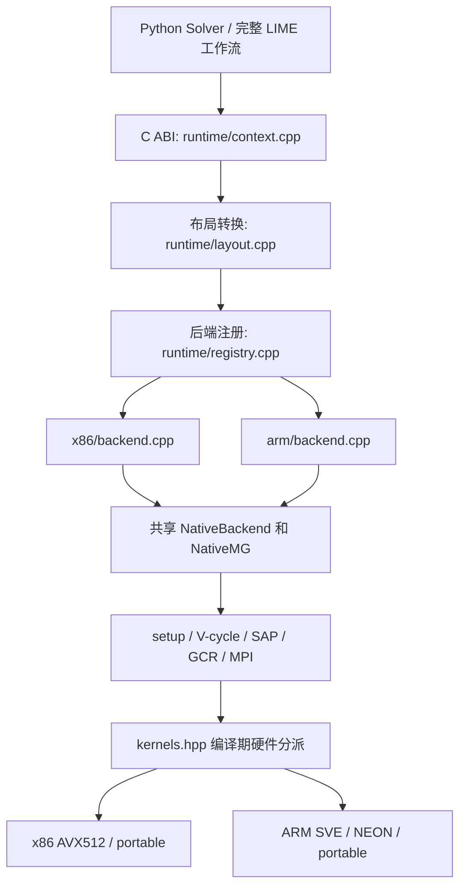
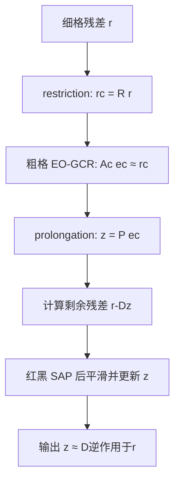
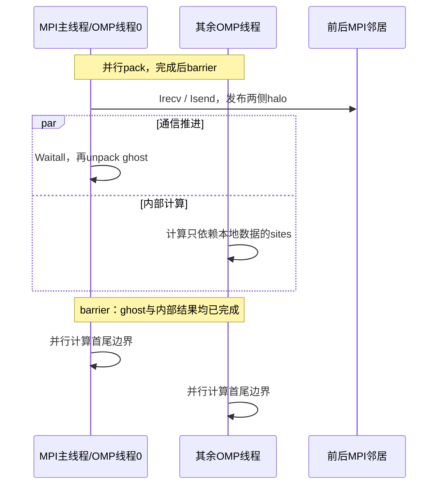

# multigrid.cpp：项目结构、算法与 CPU 后端源码导读

本文按 **2026-10-26 工作区源码**说明实现，面向准备阅读、修改或移植本项目的人。
先建立物理方程、数据映射和调用顺序，再解释 SIMD、NUMA 和通信优化。
文中的“已实现”以当前生产路径为准；历史性能记录只代表对应版本和配置。

生产求解器是项目自己的两层自适应聚合 MG。x86、ARM 是硬件后端；
DDalphaAMG 是算法参考和可选对照适配器。共同算法位于 `src/solver/native/`。
硬件内核经常写在 `.hpp` 中，以便模板展开和内联；下文同时标出调用它们的 `.cpp`。

## 目录

- [第一章：项目结构与一次求解的入口](#第一章项目结构与一次求解的入口)
- [第二章：Multigrid 算法、映射和并行流程](#第二章multigrid-算法映射和并行流程)
- [第三章：x86 后端的具体实现](#第三章x86-后端的具体实现)
- [第四章：灵晟 ARM 后端的初步实现](#第四章灵晟-arm-后端的初步实现)
- [附录 A：符号与变量对照](#附录-a符号与变量对照)
- [附录 B：源码阅读路线与改动位置](#附录-b源码阅读路线与改动位置)
- [附录 C：PyQUDA 布局、传播子与归一化](#附录-cpyquda-布局传播子与归一化)
- [附录 D：构建、运行与性能计时](#附录-d构建运行与性能计时)
- [附录 E：正确性验证与当前限制](#附录-e正确性验证与当前限制)
- [附录 F：参考资料](#附录-f参考资料)

## 第一章：项目结构与一次求解的入口

### 1.1 项目求解什么

给定规范场 $U$、质量 $m$、clover 系数 $c_{sw}$ 和源 $\eta$，
求 Wilson–Clover 方程

$$
M\psi=\eta.
$$

一个格点上的费米子场有 $4\text{ spin}\times3\text{ color}=12$ 个复数。
给定一个源位置，分别求解12个 spin/color 单位点源，就得到完整点源传播子的12列。
这12个物理源，与 setup 使用的24个测试向量是不同的对象。

运行库内部使用归一化算子

$$
D=\frac{M}{4+m}=2\kappa M,\qquad \kappa=\frac{1}{2(4+m)}.
$$

因此公共 `mass` 模式输入单位源时，内部求解 $D\psi=\eta/(4+m)$，
输出仍是 $M^{-1}\eta$。源码里 `apply_dirac()` 使用的也是这个归一化算子；
函数名与注释中的 `M`、`D` 要结合归一化理解。

源码：[公共接口](../include/lqcd/lqcd.h)、
[native/backend.cpp](../src/solver/native/backend.cpp) 的 `solve()`、`apply()`，
[core/dirac.cpp](../src/core/dirac.cpp)。完整布局见附录 C。

### 1.2 目录按职责分层

```text
multigrid.cpp/
├── include/lqcd/
│   ├── lqcd.h                    公共 C ABI：配置、字段、结果和生命周期
│   └── core/                     独立 double 算子、几何及 coarse 数据声明
├── src/
│   ├── runtime/                  参数检查、布局转换、后端注册、最终残差门
│   ├── solver/native/            共享 MG、SAP、Krylov、MPI、setup
│   ├── backends/
│   │   ├── x86/                  AVX512 Wilson/Clover、P 插值内核
│   │   ├── arm/                  portable/NEON/SVE 内核与 ARM 工厂
│   │   └── portable/             共同 Wilson 数学及 SIMD 回退实现
│   ├── support/                  对齐内存、可选 HBM 页放置
│   ├── core/                     double 基础实现；也用于 Galerkin 组装
│   ├── reference/                独立 multigrid 可执行程序和验算入口
│   └── references/ddalphaamg/     可选外部库对照适配器
├── python/lqcd_cpu/              Solver、LIME、stout、传播子 I/O
├── tools/                       构建、NUMA 启动、完整传播子和调度脚本
├── profiles/                    测量过的硬件/求解参数配置
├── tests/                       内核、MPI、接口、物理 oracle 测试
├── benchmarks/                  生产计时、native 组件和外部库对比
├── docs/                        算法、移植、用法及测量记录
└── build/                       编译产物；不是另一套源码
```

`src/core/` 不能整体理解成“生产完全不用”：生产 setup 会调用其中的 clover 构造和
Galerkin 粗化。独立验证的关键是，最终 scalar oracle 重新调用普通 double 完整算子，
不依赖生产 float SIMD、块内 Schur 和 MG 迭代结果。

### 1.3 从 Python 到硬件内核



`x86/backend.cpp` 和 `arm/backend.cpp` 都调用 `make_native()`。
它们不复制 MG 算法；实际区别来自 `kernels.hpp` 选择的计算内核。
CMake 根据目标架构编入对应硬件工厂，这不是一份二进制在任意 ISA 间自动切换。

源码：[registry.cpp](../src/runtime/registry.cpp)、
[x86/backend.cpp](../src/backends/x86/backend.cpp)、
[arm/backend.cpp](../src/backends/arm/backend.cpp)、
[native/backend.cpp](../src/solver/native/backend.cpp)、
[kernels.hpp](../src/solver/native/kernels.hpp)。

### 1.4 生命周期：建一次层级，求解多个源

```text
create → load_gauge → setup → solve / solve_batch / apply（可重复）→ destroy
```

`load_gauge` 接收当前 rank 的字段，当前实现收集规范场并构造 clover。
`setup` 生成近零空间、构造 P/R 和粗算子、预计算局部逆并执行数值检查。
`solve` 共用这些资产，但每个 RHS 的解都从零开始。复用层级、内存分配与复用旧解
是不同的行为；本项目性能验收使用前两者，每次求解不使用旧解作初值。

公共接口负责状态、参数和源保护检查；native 求解完成后，runtime 还会重新计算
完整 double 残差，必要时做有界的 defect correction。

源码：[context.cpp](../src/runtime/context.cpp) 的 `lqcd_create()`、`lqcd_setup()`、
`lqcd_solve()`、`lqcd_solve_batch()`，
[Python Solver](../python/lqcd_cpu/__init__.py)。

### 1.5 核数、NUMA、MPI 和 SIMD 是四件事

| 层次 | 负责什么 | 当前实现 |
|---|---|---|
| MPI rank | 拥有一段格点与 Krylov 向量，交换跨 rank 邻居 | 完整 aggregate 对齐的 t-slab |
| NUMA 放置 | 让 rank/线程使用指定物理核，减少跨域访存 | `tools/run_numa.py` |
| OpenMP | 在一个 rank 的核组内分配 box、格点和向量操作 | `parallel for`、线程局部工作区 |
| SIMD | 一个线程同时处理多个 site 的同一分量 | x86 AVX512、ARM SVE/NEON |

默认可以每 NUMA 一个 MPI，但这不是算法常量。x86 实测还使用每 NUMA 两个 MPI。
`threads` 是每个 rank 的线程数，可通过 collective `set_threads()` 修改，层级不重建。
当前几何要求 MPI 数能整除时间方向粗格点数，不能任意增加 rank。

当前接口每个 MPI 进程只允许一个活跃 context；调用由 MPI 主线程发起。
神威从核执行仍需独立设计，不能直接把从核数当作 OpenMP 线程数。

源码：[run_numa.py](../tools/run_numa.py) 的 `discover_nodes()`、`make_plan()`、
`rank_environment()`，以及 [context.cpp](../src/runtime/context.cpp) 的 `lqcd_set_threads()`。

## 第二章：Multigrid 算法、映射和并行流程

### 2.1 为什么既需要 SAP，又需要粗格子

Wilson–Clover 是四维最近邻稀疏算子：一个 site 耦合自身和正负四个方向的8个邻居。
其归一化形式为

$$
(D\psi)(x)=C(x)\psi(x)-\kappa\sum_{\mu=0}^{3}
\left[(I-\gamma_\mu)U_\mu(x)\psi(x+\hat\mu)
+(I+\gamma_\mu)U_\mu^\dagger(x-\hat\mu)\psi(x-\hat\mu)\right].
$$

这里 (C(x)) 已包含单位对角和 clover 项。时间边界的反周期符号需要另外作用在跨
全局时间边界的 hopping 上，不能把它误加到每个 MPI 分界面。

局部松弛可以高效降低一部分误差，但对缓慢衰减的误差分量效果有限。
自适应聚合 MG 用近零空间测试向量描述这些分量，再把它们的系数放到粗格子上求解。
在规范场上，“慢误差”不能简单等同于自由场的几何低频；P 必须随给定算子构建。

本实现由粗格修正处理这部分误差，由红黑 SAP 处理局部剩余误差，再让 flexible GCR
组织整个迭代。奇偶预处理进一步降低 SAP 和粗格求解的成本；它与近零空间粗化配合，
各自承担不同工作。

源码：[core/dslash.cpp](../src/core/dslash.cpp)、[core/clover.cpp](../src/core/clover.cpp)，
生产完整算子：[fine_operator.cpp](../src/solver/native/fine_operator.cpp)、
[double_operator.cpp](../src/solver/native/double_operator.cpp)。

### 2.2 细格子到 box，再到粗格点

设细格尺寸为 $L=(L_x,L_y,L_z,L_t)$，aggregate/box 尺寸为

$$
b=(b_x,b_y,b_z,b_t),\quad B=b_xb_yb_zb_t.
$$

当前实现让一个 aggregate 同时作为一个 SAP box；粗格子每个点对应一个这样的
四维细块。对细坐标 $x=(x,y,z,t)$，映射为

$$
X_\mu=\left\lfloor x_\mu/b_\mu\right\rfloor,\qquad
\ell_\mu=x_\mu\bmod b_\mu.
$$

`X` 决定 coarse site，`ell` 决定这个粗点所代表的细块里的位置。
在 x 最快的词典序下，

$$
\begin{aligned}
cb&=(((X_t C_z+X_z)C_y+X_y)C_x+X_x),\\
ls&=(((\ell_t b_z+\ell_z)b_y+\ell_y)b_x+\ell_x),
\qquad C_\mu=L_\mu/b_\mu.
\end{aligned}
$$

实际例子：$24^3\times64$，box 为 $6\times6\times6\times4$。

| 对象 | 大小 |
|---|---:|
| 一个细块的 site 数 $B$ | 864 |
| 粗格尺寸 $(C_x,C_y,C_z,C_t)$ | ((4,4,4,16)) |
| coarse site 数 | 1024 |
| 细场复数自由度 | $884736\times12=10616832$ |
| 粗场复数自由度 | $1024\times48=49152$ |

例如细坐标 ((13,7,20,9)) 映射到粗坐标 ((2,1,3,2))，
块内坐标 ((1,1,2,1))，因此 `cb=182`、`ls=295`。
细块本身还包含许多 site；coarse site 并不是挑其中一个细 site 代表其他 site。

源码：[core/multigrid.cpp](../src/core/multigrid.cpp) 的 `coarse_site_index()`、
`local_site()`，以及 [hierarchy.cpp](../src/solver/native/hierarchy.cpp) 的 `Impl` 构造函数。

### 2.3 24个测试向量，为什么产生48个粗自由度

setup 生成24个全场测试向量 $v_0,\ldots,v_{23}$。它们描述近零空间的候选方向，
并不要求是精确特征向量。将每个向量限制到一个 box，再分成两个手征部分：

$$
\Pi_\pm=\tfrac12(I\pm\gamma_5).
$$

在当前 DeGrand–Rossi 排列中，两个部分分别使用 spin 0/1 与 spin 2/3，每部分有
$2\times3=6$ 个 spin/color 分量。源码用 `cs=0/1` 表示它们，每个 `cs` 保留24个
局部正交向量，所以一个粗点有 $2\times24=48$ 个复数自由度。

```text
同一个细 box
  spin 0/1 × 3 color × B sites ── 局部24维基 ── coarse[0:24]
  spin 2/3 × 3 color × B sites ── 局部24维基 ── coarse[24:48]
```

`cs` 不是格点奇偶，也不是两个 RHS。`coarse_dof=48` 是当前生产实现的固定约束。
虽然每个粗点有48个分量，比细点的12个多，但在本例中每个粗点替代864个细点，
所以总系统仍缩小216倍。一般块大小下，未知数缩减比为 $12B/48=B/4$。
粗点之间的耦合则变成一般的 $48\times48$ 复矩阵。

源码：[setup.cpp](../src/solver/native/setup.cpp) 的 `generate_basis()`，
[native/backend.cpp](../src/solver/native/backend.cpp) 的 `setup()`。

### 2.4 P：从粗系数重建细场

把某 box 的局部正交基写为 $P_X\in\mathbb C^{12B\times48}$。全局 P 按这些
不相交的 box 排列，数学维数为

$$
P\in\mathbb C^{12V_f\times48V_c}.
$$

P 不会以这个巨大的全局稠密矩阵存储。一个细 site 只对应自己 box 的48个粗分量；
手征分离又使它只需读取其中24个。若 `a=spin*3+color`，其手征为 `cs=a/6`，则

$$
(Pe_c)_{X,ls,a}=\sum_{v=0}^{23}
P_X(ls,a,24\,cs+v)\ e_c(X,24\,cs+v).
$$

这一步叫 prolongation/interpolation。它把粗格的误差系数变成整个细块上的误差形状，
并不只是把一个数复制864次。`prolongate_add()` 使用 `+=`，允许把粗格修正加到已有
细格解上；当前 V-cycle 在调用它之前把修正置零。

源码：[cycle.cpp](../src/solver/native/cycle.cpp) 的 `prolongate_add()`；
普通 double 形式见 [core/multigrid.cpp](../src/core/multigrid.cpp) 的 `prolong_field()`。

### 2.5 R：把细格残差投影成粗格残差

本实现取

$$
R=P^\dagger\in\mathbb C^{48V_c\times12V_f},
$$

因此

$$
(Rr)(X,24\,cs+v)=
\sum_{ls=0}^{B-1}\sum_{a=6cs}^{6cs+5}
\overline{P_X(ls,a,24\,cs+v)}\ r(X,ls,a).
$$

这里必须取复共轭。R 计算的是细残差在局部基上的系数，不是粗暴平均，也不是独立
训练另一份矩阵。代码共用 `basis`，分别进行共轭投影和正向线性组合。
默认 restriction 用 double 累加，输出存回 float。

局部 MGS 保证 $P^\dagger P\approx I_c$。但 $PP^\dagger$ 是细空间中的投影，
只保留 P 张成的近零子空间，因此通常不等于 $I_f$。`R*P` 检查通过，不意味着
任意细场都能不丢信息地经过 `fine → coarse → fine`。

源码：[cycle.cpp](../src/solver/native/cycle.cpp) 的 `restrict_to_coarse()`；
[validation.cpp](../src/solver/native/validation.cpp) 的 `NativeMG::verify()` 检查 `R*P`。

### 2.6 为什么要保持 gamma5 结构

Wilson–Clover 满足 gamma5-Hermitian 结构。上述手征聚合使

$$
\gamma_5P=P\Gamma_{5,c},\qquad
\Gamma_{5,c}=\operatorname{diag}(I_{24},-I_{24}).
$$

结合 $D^\dagger=\gamma_5D\gamma_5$，可得粗算子也满足

$$
A_c^\dagger=\Gamma_{5,c}A_c\Gamma_{5,c}.
$$

这保留了原算子的关键代数结构。实现并不是每次 matvec 都额外旋转 gamma5，
而是在构造 P 时将两个手征子空间分开正交化，直接以字段排列体现这一结构。

源码：[setup.cpp](../src/solver/native/setup.cpp) 的 `for(cs=0;cs<2;...)`，
[core/dslash.cpp](../src/core/dslash.cpp) 的 `gamma_init()`。

### 2.7 粗算子 $A_c=RDP$ 如何构造

粗方程来自把细方程限制到 P 的子空间：

$$
De\approx r,\quad e\approx Pe_c
\quad\Longrightarrow\quad
\underbrace{RDP}_{A_c}e_c=Rr.
$$

`assemble_local_block()` 对一个源 box 的 P 列施加 fine clover/hopping，再与目标
box 的基做共轭内积。因为 fine D 是最近邻算子，结果只有粗格 onsite 和正负四个
方向的邻居块，形成9点 stencil：

```text
stencil[coarse_site][onsite,+x,-x,+y,-y,+z,-z,+t,-t][row48][column48]
```

粗算子是由投影得到的矩阵块，不是把原 SU(3) gauge 简单抽稀后再调用原 Wilson
公式。生产求解使用预组装 stencil；不会每次 coarse matvec 都完整执行一次 P、D、R。
`P → D → R` 的直接计算保留为组成验证，检查它与 stencil 的作用一致。

源码：[core/multigrid.cpp](../src/core/multigrid.cpp) 的 `assemble_local_block()`、
`rebuild_coarse_operator()`；[coarse.cpp](../src/solver/native/coarse.cpp) 的
`coarse_block_apply()`、`coarse_apply()`；[validation.cpp](../src/solver/native/validation.cpp)。

### 2.8 Setup 的实际流程

默认 setup 参数为 `smooth=12`、`passes=2`、每 pass `iterations=3`。
其主要步骤是：

1. 建立可执行初始平滑的层级容器，生成24个随机 float 测试向量。
2. 对齐次方程 $Dv=0$ 执行 SAP 平滑：`sap(zero, v, smooth)`。
3. 在每个 box、每个 chirality 内，对24个候选向量做两遍 MGS 和归一化，得到 P。
4. 组装 $A_c=P^\dagger DP$，重建 native 系数、索引和局部逆。
5. 默认进行两次自适应 pass，每次对已有候选做3次近似逆更新，再重复局部正交化和粗化。
6. 执行完整算子、P/R、RAP、Schur 组成门；通过后才允许生产求解。

默认 `LQCD_SETUP_UPDATE=inverse` 使用

$$
v\leftarrow\mathcal C v,\qquad v\leftarrow v/\|v\|,
$$

其中 $\mathcal C$ 是当前 MG 近似逆，不是精确的 $D^{-1}$。
诊断选项 `paper` 使用

$$
v\leftarrow v+\mathcal C(v-Dv),
$$

随后归一化。默认与论文式更新应区分记录。每个 pass 完成后重新正交化和重建粗算子，
不是仅修改测试向量却继续沿用旧 $A_c$。生产 setup 不需要从 QUDA 导入 P。

源码：[native/backend.cpp](../src/solver/native/backend.cpp) 的 `setup()`、
[setup.cpp](../src/solver/native/setup.cpp) 的 `generate_basis()`、
[hierarchy.cpp](../src/solver/native/hierarchy.cpp) 的 `Impl` 构造函数。

### 2.9 一次 V-cycle：当前是“粗修正，再 SAP”

给预条件器的输入是当前残差 `r`，输出是近似修正 `z`：



对应伪代码：

```text
apply_vcycle(r):
    z = 0
    rc = restrict_to_coarse(r)
    ec = coarse_solve(rc)
    prolongate_add(ec, z)
    sap(r, z, sap_cycles)
    return z
```

当前没有另加一个 pre-SAP；SAP 函数内部根据已有 `z` 计算残差并更新。
形式上令 $Q=P\widetilde A_c^{-1}R$，后平滑修正算子为 $S_{SAP}$，则

$$
\mathcal C=Q+S_{SAP}(I-DQ).
$$

这个式子是算法组成的形式记号。粗 GCR 的停止路径、局部 MR 的系数依赖输入残差，
实际 $\mathcal C$ 通常可变或非线性，不能当作预先存好的一张固定逆矩阵。
逐步操作始终是先算 $z_0=P\,\mathrm{coarse\_solve}(Rr)$，
再依据 $r-Dz_0$ 执行 SAP 修正；这也是选择 flexible 外层的原因。
粗方程只需近似求解，因为 $\mathcal C$ 是 flexible 外层的预条件器。
粗层达到自己的宽松阈值，不代表原完整方程已经达到 $10^{-8}$。

源码：[cycle.cpp](../src/solver/native/cycle.cpp) 的 `apply_vcycle()`；
两列版本在 [batched_cycle.cpp](../src/solver/native/batched_cycle.cpp)。

### 2.10 三个容易混淆的“红黑/奇偶”

| 层次 | 着色/奇偶依据 | 用途 | 实现 |
|---|---|---|---|
| 细 site 的 EO | $(x+y+z+t)\bmod2$ | 一个 SAP box 内做 Schur 消元 | `sap.cpp` |
| SAP box 红黑 | $(X_x+X_y+X_z+X_t)\bmod2$ | 同色 box 并行、异色顺序更新 | `sap.cpp`、`hierarchy.cpp` |
| 粗格 EO | coarse site 的同一 box 颜色 | 粗算子 Schur 消元与重建 | `coarse.cpp` |

例如前面的细点 ((13,7,20,9)) 是 odd site，但其 box ((2,1,3,2)) 是 even box。
一个 red box 内同时包含 even 和 odd 细 site；不能把“红 box”理解成“只存细偶点”。
PyQUDA 的 EO-x 输入布局是第四个相关概念：它是外部存储排列。runtime 会先转换，
它不意味着整个外层只求解一个全局细格 Schur 方程。

### 2.11 块内 EO-Schur：先消去 odd，再重建

把一个 box 内的 Dirichlet 算子按细 site parity 排列为

$$
A_{box}=\begin{bmatrix}C_e&H_{eo}\\H_{oe}&C_o\end{bmatrix}.
$$

$C_e,C_o$ 是各自 site 上的 clover 对角块；hopping H 已包含 signed $-\kappa$。
消去 odd 分量后得到

$$
S_e=C_e-H_{eo}C_o^{-1}H_{oe},\qquad
r'_e=r_e-H_{eo}C_o^{-1}r_o.
$$

在 even 分量上做有限次最小残差 MR：

$$
w=S_ep,\qquad \alpha=\frac{w^\dagger p}{w^\dagger w},\qquad
\delta_e\leftarrow\delta_e+\alpha p,\quad p\leftarrow p-\alpha w.
$$

这里初始 $p=r'_e$。最后用原 odd 残差重建

$$
\delta_o=C_o^{-1}(r_o-H_{oe}\delta_e).
$$

因此 odd 部分没有被丢掉。clover 在当前手征排列下是两个 $6\times6$ 块，
setup 中预先求逆，SAP 热循环只做 inverse matvec。
块外邻居在这个局部解中被设为零，即 Dirichlet 截断；整个算子的跨 box 耦合仍由
每一色更新前的全局 `fine_apply()` 计入残差。

源码：[sap.cpp](../src/solver/native/sap.cpp) 的 `solve_sap_block_eo()`；
[hierarchy.cpp](../src/solver/native/hierarchy.cpp) 的 `build_clover_inverse()`；
[fine_operator.cpp](../src/solver/native/fine_operator.cpp) 的 `local_range()`、`clover_range()`。

### 2.12 红黑 SAP：同色并行，两色有序

一次 SAP cycle 顺序为：

```text
for color in [red, black]:
    image = D * current_solution，只计算当前颜色需要的输出
    parallel for 本 rank 的当前颜色 boxes:
        r_box = source_box - image_box
        delta_box = 近似求解 A_box * delta_box = r_box（EO-Schur MR）
        current_solution_box += delta_box
```

同色 box 不直接最近邻耦合，所以可以同时更新各自的解。
black 阶段重新计算 residual image，会看到 red 阶段的更新；跨 MPI 分界面的更新
由下一次 halo 交换传递。颜色之间的顺序不能随意去掉，否则会改变乘法 Schwarz 平滑器。

每个 OpenMP 线程复用 `rr/ar/dx` 三个块工作区，避免每个 box、每个 V-cycle 重复分配。
`sap_steps` 是每次局部 MR 的预算；`sap_cycles` 是红黑对的次数，二者不是外层迭代数。

源码：[sap.cpp](../src/solver/native/sap.cpp) 的 `sap()`；
颜色表 `colors[cb]` 在 [hierarchy.cpp](../src/solver/native/hierarchy.cpp) 构造；
两列版本在 [batched_sap.cpp](../src/solver/native/batched_sap.cpp)。

### 2.13 粗格 EO-GCR

粗层也有 onsite 和跨 parity 邻居。令每个粗点的 onsite 矩阵为 $B_X\in\mathbb C^{48\times48}$，
同样构造

$$
S_{c,e}=B_e-H_{c,eo}B_o^{-1}H_{c,oe}.
$$

`coarse_reduced_rhs()` 形成消元后的 RHS，`coarse_schur()` 施加粗 Schur 算子，
`coarse_solve_eo()` 使用 onsite inverse 预条件的 GCR 近似求解 even 部分，
`coarse_reconstruct()` 重建完整48分量粗场，再交给 P。

默认粗层最多40次迭代、重启长度16，停止阈值约为原 coarse RHS 范数的0.1；
具体数值可由 solve tuning 调整。粗格向量只保存 owned coarse sites，点积/范数
通过 MPI 全局归约，因此各 rank 对停止与重启作一致决定。

源码：[coarse.cpp](../src/solver/native/coarse.cpp) 的上述函数；
onsite inverse 在 [hierarchy.cpp](../src/solver/native/hierarchy.cpp) 构造。

### 2.14 外层 flexible GCR 与可靠 double 校正

默认生产流程可以理解为“double 缺陷校正包住 float flexible GCR”。
给定一个 double 残差，float GCR 每步计算

$$
z_k=\mathcal C(r_k),\qquad q_k=D_fz_k.
$$

随后对旧方向正交化，q 和 z 必须成对变换，保持 $D_fz\approx q$。归一化后，

$$
\alpha_k=q_k^\dagger r_k,\quad
x_f\leftarrow x_f+\alpha_kz_k,\quad r_f\leftarrow r_f-\alpha_kq_k.
$$

使用 flexible 方法允许 MG 中的近似粗解和停止路径变化。
默认流程如下：

```text
x_double = 0
r_double = b
repeat（受总迭代预算和最多12次校正限制）:
    将当前 double residual 编码成 float
    float flexible GCR 求出近似 delta
    x_double += decode(delta)
    r_double = b - D_double * x_double
    只有 ||r_double|| / ||b|| 达标才能成功返回
```

float GCR 默认重启长度24，重启时重新施加 float D 刷新 residual。
允许在一个 float correction 结束时省掉重复 float 验算，因为后面必有 double 完整
残差检查；这不等于降低最终精度。最终 runtime 还会用公共 mass 归一化再次验算。

`iterations` 统计实际消耗的 Krylov/V-cycle 步数，不包含 setup，也不等于 reliable
correction 次数。`refinement_steps` 是 runtime 最终门失败后额外补救的次数，
又与 native 内部的可靠校正循环不同。

源码：[solver.cpp](../src/solver/native/solver.cpp) 的 `solve_float_gcr()`、`NativeMG::solve()`；
[double_operator.cpp](../src/solver/native/double_operator.cpp) 的 `apply_double()`；
[context.cpp](../src/runtime/context.cpp) 的 `lqcd_solve()`。

### 2.15 MPI 分解与计算/通信异步重叠

目前 MPI 几何是 $(1,1,1,N_{rank})$：每个 rank 拥有连续 t-slab。
它必须包含完整 aggregate，所以 $C_t\bmod N_{rank}=0$。
对24³×64、bt=4，8 rank 每个有8个物理时间片、2个粗时间片；16 rank 每个只有
4个物理时间片、1个粗时间片。

fine/double 算子只需交换前后各一个物理 t 面。当前做法不是把边缘整个 box 都延后：
边缘 box 内不依赖远端 ghost 的时间切片仍先计算，只有物理首尾面必须等待。

下面以 **float fine 的融合 OpenMP team 路径**为例画时序。
double 直接发送连续输入面，无需 pack/unpack；coarse 复制发送面后直接读取接收 ghost，
具体数据准备方式与图中不同，但通信与内部计算重叠的原则相同。



float fine 路径中，主线程完成 unpack 后还可加入剩余 interior work。
double 和 coarse 路径采用各自的 worker 分片；主线程负责通信等待。
所有 MPI 调用都留在调用并行区的 MPI 主线程，要求至少 `MPI_THREAD_FUNNELED`，
不依赖 `MPI_THREAD_MULTIPLE` 或额外后台 progress 线程。

| 路径 | 消息内容 | 可提前计算的内部工作 | 源码 |
|---|---|---|---|
| fine float | 两个物理 t 面，split real/imag，按 EO 打包 | box 内不依赖远端面的切片 | `fine_operator.cpp::fine_apply()` |
| 两列 fine | 两个 RHS 的面合并成同一批消息 | 与单列相同的物理切片 | `batched_fine_operator.cpp::fine_apply_batch()` |
| double | 词典序完整空间面，12 complex/site | 首尾面之间的本地 sites | `double_operator.cpp::apply_double()` |
| coarse | 首尾 coarse t 平面，48 complex/site | 不接触 ghost 的 coarse aggregates | `coarse.cpp::coarse_apply()` |

细格 local_t=4 时仍有中间两个物理面可计算；但粗格 local_t=1 时没有 coarse interior，
无法通过这部分计算掩盖通信。`LQCD_COARSE_EMPTY_INTERIOR` 处理这种情况。
仅调用非阻塞 MPI 并不自动获得收益，需要同时有足够内部工作、合理亲和性和通信进展。

发送数据在 `Waitall` 前必须保持不变；接收缓冲与发送缓冲分离。
两个周期邻居恰好是同一个 rank 时，也必须保持上下方向消息和 ghost 地址安全。
`LQCD_HALO_OVERLAP=0` 提供相同协议下先等待再计算的对照。

**尚未流水化的部分**：dot、norm 和 GCR 正交化仍使用阻塞 `MPI_Allreduce`；
setup 中仍有 `MPI_Allgather`。因此“halo 有异步重叠”不代表所有通信都已异步。

源码：[fine_operator.cpp](../src/solver/native/fine_operator.cpp)、
[batched_fine_operator.cpp](../src/solver/native/batched_fine_operator.cpp)、
[double_operator.cpp](../src/solver/native/double_operator.cpp)、
[coarse.cpp](../src/solver/native/coarse.cpp)、[environment.cpp](../src/solver/native/environment.cpp)。

### 2.16 两列 batch：复用数据，不改变每列方程

完整传播子可以把12列分成6组，每组两个 RHS。每列保留自己的解、残差、GCR 方向和
收敛状态；当前没有把它们组合成一个 block Krylov 子空间，也不使用前一列解作初值。

主要复用发生在：同一个 box 处理多个 RHS、合并 face 消息、减少 OpenMP 团队创建、
提高系数和 basis 的缓存复用。粗格求解当前仍按 RHS 逐个调用。
某列先达到本次 correction 的阈值后，可退出活跃集合，不必强迫另一列按同一步数停止。

源码：[batched_solver.cpp](../src/solver/native/batched_solver.cpp)、
[batched_cycle.cpp](../src/solver/native/batched_cycle.cpp)、
[batched_sap.cpp](../src/solver/native/batched_sap.cpp)。
两列统计中的 `solver_seconds` 是共享 batch 时间，不能把同一个数再加两遍。

## 第三章：x86 后端的具体实现

### 3.1 x86 优化处在算法的哪一层

x86 后端执行第二章的同一套 MG。主要硬件工作是让 `D*x`、Clover inverse、P 插值、
向量更新和块循环更有效地使用 SIMD、缓存与多核。
`src/backends/x86/backend.cpp` 是工厂；不能从这个很短的文件判断算法是否完整。

典型调用链为：

```text
solver.cpp::solve_float_gcr
  → cycle.cpp::apply_vcycle
     → coarse.cpp::coarse_solve_eo
     → cycle.cpp::prolongate_add
     → sap.cpp::sap
        → fine_operator.cpp::fine_apply
        → fine_operator.cpp::local_range / clover_range
           → x86/wilson_avx512.hpp
```

### 3.2 内部布局：先 box，再分量，再 site

外部 complex128 场先成为 rank-local 词典序 `Field`，再编码为 float split 场：

```text
fine[aggregate][spin_color=12][real_or_imag=2][site_in_box=B]
```

固定分量时，许多 site 连续存放。这样 AVX512 一条指令可以处理16个 float site。
`B=864` 时，一个分量面正好有54个16-site tile；EO 半块有432个 site。
内核仍支持起点不对齐与尾掩码，不能把“这个配置整除16”当作普遍前提。

启用 SAP EO 后，块内位置进一步变为

$$
s_{EO}=p\frac{B}{2}+\left\lfloor ls/2\right\rfloor,\quad
p=(x+y+z+t)\bmod2.
$$

前半块是 even，后半块是 odd。前面的 `ls=295`、odd site 在块内的 slot 为579。
`lex` 保存内部 slot 到全局词典序 site 的映射，`local_lex` 保存到块内词典序的映射。
二者主要在转换和 setup 使用，热循环避免反复做坐标除法。

源码：[hierarchy.cpp](../src/solver/native/hierarchy.cpp) 的 `blocked`、`lex/local_lex` 构造；
[fine_operator.cpp](../src/solver/native/fine_operator.cpp) 的 `encode_fine()`、`decode_fine()`。

### 3.3 AVX512 Wilson：半自旋投影与邻居加载

`wilson_avx512_impl` 的基本工作是：

1. 对一个16-site tile 计算 Clover，或在 hopping-only 模式把目标清零。
2. 对8个方向读取邻居 spinor。
3. 利用 $I\pm\gamma_\mu$ 的秩2结构形成 half-spinor。
4. 对两个独立 spin 分量做 SU(3) 颜色乘法，再重建其余 spin 分量并累加。

`gp/gr/gi` 预存稀疏 gamma 配对和实虚系数；`links` 预乘 $-\kappa$，包含反向
dagger 与全局时间边界相位。热循环不重新构造 gamma 矩阵或判断物理边界。

SAP 的局部邻居使用 `inner`：跨 box 的项为负，由掩码截断，实现 Dirichlet 边界。
完整 fine 算子使用全场 blocked offset 和已经交换的 ghost。

源码：[wilson_avx512.hpp](../src/backends/x86/wilson_avx512.hpp) 的
`wilson_avx512_impl()`、`wilson_avx512()`；
调用在 [fine_operator.cpp](../src/solver/native/fine_operator.cpp) 的 `local_range()`、`block_apply()`。

### 3.4 三种邻居加载：连续、gather 和安全回退

| 情况 | 做法 |
|---|---|
| 块内某 parity/方向满足 `index-site=常数`，tile不跨EO半块且地址范围安全 | masked 连续 load |
| 块内邻居不满足统一偏移 | 32位索引 gather |
| 全场 offset 可安全表示为32位 float 元素索引 | global SIMD gather |
| 全场索引超限，或该 ISA 未编译 | pointer-width portable 路径 |

连续加载的条件由真实邻居表检查，而不是只凭 box 几何猜测。
无效 Dirichlet 邻居仍必须掩码，不能让连续读取越过数组或错误使用相邻 box 的值。
`local_load_offsets` 记录每个 owned box、两个 parity、8个方向的判定结果。

全场保留 `ptrdiff_t neighbor` 作为正确性路径；满足大小门时才建立 `neighbor32`。
对当前24³×64，float fine 字段元素数为 `24*V`，在32位带符号范围内。

源码：[hierarchy.cpp](../src/solver/native/hierarchy.cpp) 的 `local_load_offsets`、`neighbor32`；
[wilson_avx512.hpp](../src/backends/x86/wilson_avx512.hpp)；
[wilson_kernel.hpp](../src/backends/x86/wilson_kernel.hpp) 的 dispatch。

### 3.5 Packed 系数：把同一 tile 的系数放近

原系数按 `[aggregate][plane][B sites]` 排列。
AVX512 的 owned 系数另外打包为

```text
packed[owned_aggregate][site_tile][coefficient_plane=144][lane=16]
```

这样一个16-site tile 所需的 links、diag 或 inverse 面在内存中更集中。
每块 stride 是 `ceil(B/16)*144*16` 个 float，尾 lane 补零。
只打包 owned aggregate，raw 数组继续保留供回退和共同算法使用。

`LQCD_WILSON_PACKED` 控制这条路径；`LQCD_LOCAL_CONTIGUOUS` 控制上一节的连续加载。
二者是不同优化：一个调整系数布局，一个调整邻居 spinor 的读取方式。

源码：[hierarchy.cpp](../src/solver/native/hierarchy.cpp) 的 packed 构造；
[fine_operator.cpp](../src/solver/native/fine_operator.cpp) 的 `use_packed_coefficients` 分支；
[wilson_avx512.hpp](../src/backends/x86/wilson_avx512.hpp) 的 `Packed` 模板参数。

### 3.6 Clover inverse 和 P 插值

`clover_range_avx512()` 对每个 site 的两个6×6手征块做矩阵向量乘法，
同一批16个 site 并行。普通 Clover 与 inverse 共用计算结构，只是输入系数不同。

P 插值的 `prolongate_component_avx512()` 则让16个 site 的结果停留在寄存器中，
循环累加24个粗基系数，最后写回。相较于每个基向量都读写 fine 输出，减少了输出
数组的反复访问。restriction 默认仍用共同循环和 double 累加，不能把整个 P/R
路径都描述成独立手写 AVX512。

源码：[wilson_avx512.hpp](../src/backends/x86/wilson_avx512.hpp)、
[transfer_avx512.hpp](../src/backends/x86/transfer_avx512.hpp)；
调用在 [cycle.cpp](../src/solver/native/cycle.cpp)、[batched_cycle.cpp](../src/solver/native/batched_cycle.cpp)。

### 3.7 GCR、线程和分配优化

共同算法中还有几类对 x86 有明显影响的优化：

- `solver.cpp` 和 `coarse.cpp` 合并 $q^\dagger q$、$q^\dagger r$ 的局部遍历与归约；
  更新 x/r 后仍测量实际存储 residual 的范数，避免用不可靠的范数递推替代它。
- 可选 `coarse_cgs2_project()` 把多个投影系数放入一次向量归约，再做第二遍正交化；
  默认仍可使用逐方向 MGS，是否更快需要测量。
- `LQCD_FINE_TEAM_FUSED` 在单列 fine 路径中融合 pack、通信重叠和计算的 OpenMP 团队，
  减少额外 parallel region。两列路径有自己的融合组织，不读取全部单列调度开关。
- `WorkspaceAllocator` 给内部数组至少64字节对齐；工作区复用减少分配、清零和页故障。
  未初始化的非 owned float 区域不能被全数组 BLAS 读取，dot/norm 只计算 owned 区间。

源码：[solver.cpp](../src/solver/native/solver.cpp)、[coarse.cpp](../src/solver/native/coarse.cpp)、
[fine_operator.cpp](../src/solver/native/fine_operator.cpp)、
[aligned_workspace.hpp](../src/support/aligned_workspace.hpp)。

### 3.8 NUMA 调优与当前 x86 边界

`run_numa.py` 按允许的物理核生成互不重叠的 rank 核组，设置 CPU affinity、
`OMP_PLACES`、`OMP_PROC_BIND`。一个 NUMA 放一个还是两个 rank，是需要测量的配置。
更多 rank 会减少每 rank 的 OpenMP 工作，但增加 halo、归约以及 setup 副本成本。

目前双9755测量用过 `16 MPI×16线程=256核` 和同一分解的 `16 MPI×8线程=128核`。
后者的128核分布在两颗 CPU，不能理解成只用一颗 CPU。
`profiles/epyc9755_physical_solver.json` 是另一组实测 solve tuning，里面的 SAP steps=5；
不能把它与历史线程扫描 SAP steps=6 的成绩当作完全相同配置。

当前手写 SIMD 重点是 float Wilson/Clover 和 P 插值。double residual、粗格 dense
matvec、setup 等还包含共同 C++/OpenMP 循环；它们可能被编译器向量化，但不是全部
都有独立手写 AVX512 内核。保留全局系数副本和同步归约也会限制强扩展。

源码：[run_numa.py](../tools/run_numa.py)、[EPYC profile](../profiles/epyc9755_physical.env)、
[solve profile](../profiles/epyc9755_physical_solver.json)。
性能背景见 [x86-performance.md](x86-performance.md)、
[node5005-perf.md](node5005-perf.md) 与 [当前跨硬件记录](hardware-comparison-20261026.md)。

## 第四章：灵晟 ARM 后端的初步实现

### 4.1 ARM 后端复用了什么

ARM 工厂进入同一个 NativeBackend、setup、P/R、SAP、coarse EO-GCR、mixed precision
和 MPI 实现。灵晟的不同主要在 ISA 内核、编译目标、线程/NUMA 放置，以及可选 HBM。
这使算法修正不必在 x86 和 ARM 各复制一份。

```text
src/solver/native/kernels.hpp
  → arm/wilson_kernel.hpp：Wilson 分派
     → SVE 已编译且启用：wilson_sve.hpp
     → 否则：portable/wilson_kernel.hpp
  → arm/clover_neon.hpp：Clover/inverse
     → SVE 已编译且启用：clover_range_sve
     → 否则：NEON，尾部标量处理
```

源码：[arm/backend.cpp](../src/backends/arm/backend.cpp)、
[kernels.hpp](../src/solver/native/kernels.hpp)、
[arm/wilson_kernel.hpp](../src/backends/arm/wilson_kernel.hpp)。

### 4.2 NEON 基线与 SVE 路径的区别

基础 ARM 实现为 Clover/inverse 提供4-lane float NEON 内核。
Wilson fallback 使用共同 portable 内核和 OpenMP SIMD，并不是一套完整手写 NEON Wilson。

灵晟计算节点已实测可用 SVE，当前向量长度64字节，即16个 float lane。
显式 SVE 实现使用 `svcntw()` 决定步长、`svwhilelt_b32()` 生成尾谓词；
不会把“每次一定16个 site”写死在循环中。

SVE 路径受 `__ARM_FEATURE_SVE` 编译宏和 `LQCD_ARM_SVE` 开关共同控制。
开关在进程内首次读取后缓存，应在启动前设置。它不是运行时 CPU 能力检测器：
针对 SVE 机器用 `-march=native` 构建的二进制，不保证能放到无 SVE 的机器上运行。
Kunpeng 和灵晟应按实际目标分别构建，不能仅凭“都是 ARM”共用任意 native 二进制。

源码：[clover_neon.hpp](../src/backends/arm/clover_neon.hpp) 的 `clover_range_neon()`；
[wilson_sve.hpp](../src/backends/arm/wilson_sve.hpp) 的 `sve_enabled()`、`clover_range_sve()`。

### 4.3 SVE Wilson 的实现步骤

`wilson_sve<Local,Offset,Clover>()` 与 x86 保持相同数学和 split 布局：

1. 对当前输出范围做 Clover，或清零 hopping-only 输出。
2. 每个方向加载邻居索引，局部负索引通过谓词屏蔽。
3. 用 `svld1_gather_s32index_f32()` 取邻居 spinor；索引单位是 float 元素，不是字节。
4. 计算两个独立 spin 的 half-spinor，做颜色乘法并重建另外两个 spin。
5. 按当前谓词写回，处理局部 EO 半块、不对齐起点及最后不足一向量的 site。

global 原始邻居表仍是 `ptrdiff_t`。只有完整 float 字段元素数不超过 `INT_MAX` 才
允许转成 SVE 的32位 gather 索引；否则走 portable。局部 SAP 使用32位块内索引。

当前 ARM 没有自动复用 x86 的 packed16系数。默认P插值走共同循环；手册驱动的
局部连续加载/compact邻居表与SVE插值tile候选分别由`LQCD_ARM_SVE_PLANNED`、
`LQCD_ARM_SVE_TRANSFER`控制，均默认关闭，详见[本轮优化记录](kunpeng-hpc-optimization.md)。
SVE 也没有覆盖整个 double/粗格/setup 路径，因此单个 hopping 内核加速2.5倍，
不代表完整传播子也加速2.5倍。当前没有生产 SME 内核。

源码：[wilson_sve.hpp](../src/backends/arm/wilson_sve.hpp) 的 `sve_indices()`、`wilson_sve()`；
[arm/wilson_kernel.hpp](../src/backends/arm/wilson_kernel.hpp) 的 `wilson_local_dispatch()`、
`try_wilson_global_simd()`；调用仍在 [fine_operator.cpp](../src/solver/native/fine_operator.cpp)。

### 4.4 灵晟的 MPI/OpenMP 组织

当前计算节点为双路304核，共16个 CPU NUMA，每域38核。
调度分配每域保留1核，实际使用每 rank 37线程：

| 配置 | MPI | 每rank线程 | 实际物理核 | 每rank物理/粗时间片 |
|---|---:|---:|---:|---|
| 前8 NUMA | 8 | 37 | 296 | 8 / 2 |
| 全16 NUMA | 16 | 37 | 592 | 4 / 1 |

NUMA 启动器从当前允许的 CPU 集合发现拓扑，算法里没有常量304或608。
多一倍核数会改变 rank 的 slab 厚度与通信/计算比例，尤其16 rank 的 coarse interior
为空；这也是不能只按核心数量推算速度的原因。

当前实测是单节点。共同 MPI 代码提供了跨 rank halo，但全局 setup 资产、副本和
仅 t 方向分解仍是扩大到多节点时必须继续处理的限制。

源码：[run_numa.py](../tools/run_numa.py)、
[benchmark_numa_scaling.py](../tools/benchmark_numa_scaling.py)、
[donau_lingsheng_scaling.sh](../tools/donau_lingsheng_scaling.sh)。

### 4.5 HBM：已有放置接口，当前成绩仍来自 DDR

HBM 放置在最终 hierarchy 通过数值门后执行。当前逻辑：

1. 根据 `LQCD_NUMA_NODE`、sysfs 距离、memory-only 节点和 `Mems_allowed_list` 选择候选。
2. 只考虑本 rank owned 的 links、diag、clover inverse、basis、coarse 系数/逆和邻居索引。
3. 每 rank 总预算1GiB；超过剩余预算的整个 range 跳过。大 setup 副本和 Krylov 工作区留在 DDR。
4. 只迁移完整页，使用 `mbind` 的 bind/move/strict 语义，并通过 `move_pages` 抽样查询驻留。
5. `prefer` 失败时记录原因后继续；`require` 任一 rank 失败时 collective 报错。

memory-only 只是拓扑特征，不自动证明是 HBM；必须用平台信息核对内存类型。
CPU affinity 也不代表页已经位于 HBM。日志中的目标、绑定字节和抽样驻留需要一起看。

2026-10-26 作业只允许 DDR 节点0–15，HBM节点16–31被排除，实际
`target=-1`、`bound_bytes=0`。因此目前没有 HBM 性能收益证据，SVE 加速不能归因于 HBM。

源码：[memory_placement.cpp](../src/solver/native/memory_placement.cpp) 的 `NativeMG::place_hot_data()`；
[hbm_placement.hpp](../src/support/hbm_placement.hpp) 的计划选择、页范围与放置/验证逻辑。

### 4.6 已验证到什么程度

在同一独占节点、同一库、同一物理输入下，第二次12列内部纯求解计时如下。
不包含 setup、stout、读写或计时外独立验证：

| 实际核数 | 显式SVE核关闭 | 显式SVE核开启 | 加速 |
|---|---:|---:|---:|
| 296 | 46.456866秒 | 38.957395秒 | 1.193× |
| 592 | 29.452243秒 | 22.725742秒 | 1.296× |

两列使用同一 `-march=native` 二进制，通过 `LQCD_ARM_SVE` 切换显式内核。
关闭时 portable/OpenMP SIMD 循环仍可能被编译器向量化为 SVE，不能解释成“完全无SVE指令”。

两组 SVE 输出的12列全部经独立 scalar double 完整算子复核，最大相对残差分别为
`4.818817693e-9`、`4.818843169e-9`。这证明当前路径可用，尚不证明平台已调至最优，
也未达到完整12列5秒目标。

验证代码：[arm_sve_test.cpp](../tests/unit/arm_sve_test.cpp)、
[arm_kernel_test.cpp](../tests/unit/arm_kernel_test.cpp)、
[hbm_placement_test.cpp](../tests/unit/hbm_placement_test.cpp) 及 MPI/runtime 测试。
测量细节：[arm-sve-hbm.md](arm-sve-hbm.md)、
[hardware-comparison-20261026.md](hardware-comparison-20261026.md)。

### 4.7 后续优化应放在哪一层

| 工作 | 修改位置 | 需要验证什么 |
|---|---|---|
| SVE 连续邻居加载、系数打包 | `backends/arm/`，必要时扩展 `hierarchy.cpp` 的计划数据 | EO/尾部/Dirichlet与 portable 一致 |
| P/R、coarse dense 内核 | ARM专用内核与共同 dispatch | P†P、RAP、迭代数与完整残差 |
| 本地化 setup 资产、减少副本 | `native/backend.cpp`、`setup.cpp`、`hierarchy.cpp` | 分布式所有权与所有 rank 一致性 |
| 4D分解、rank合并或粗层进程缩减 | 共享几何、halo、coarse/transfer 层 | 不只是 ARM 内核问题 |
| HBM热点选择与预算 | `memory_placement.cpp`、`support/hbm_placement.hpp` | 真实驻留、容量、NUMA局部性和速度 |
| 归约流水化 | `solver.cpp`、`coarse.cpp`、`environment.cpp` | 数值稳定性、collective顺序和精度 |

前两项偏硬件后端，后几项偏共同求解框架。算法与执行分离的目的，是让同一次
数学/通信修正可以服务 x86、灵晟和未来神威实现，同时允许各自选择不同微内核。

## 附录 A：符号与变量对照

| 文中对象 | 代码变量/类型 | 含义 |
|---|---|---|
| fine site 数 $V_f$ | `fine_sites`、`n_fine` | 全局细格体积 |
| 一个 box 的 site 数 $B$ | `block_sites`、`block_volume` | 四个 block extent 的乘积 |
| coarse site 数 $V_c$ | `aggregate_count`、`n_coarse` | fine box 数 |
| coarse 自由度 | `coarse_dof=48` | 两个手征×24个局部基 |
| coarse site 编号 | `cb` | 这里表示 aggregate 编号，不等同 parity |
| 手征 | `cs`、`a/6` | 0/1，分别使用6个 spin/color 分量 |
| box 颜色 | `colors[cb]` | coarse 坐标和的奇偶 |
| owned 区间 | `first_aggregate:end_aggregate` | 当前 rank 拥有的全局 aggregate 编号 |
| 一层 coarse t 面 | `aggregates_per_tslice` | `cx*cy*cz` |
| P 的存储 | `Multigrid::basis`、`Impl::basis` | 同一数学基的 double 普通排列和 float split 排列 |
| 粗算子 | `stencil`、`coarse` | 9个48×48复矩阵块 |
| 精度较高的外部/可靠校正场 | `Field` | `complex<double>`，生产向量为 rank-local lexical |
| MG内核工作场 | `FloatField` | 64字节对齐 float 数组，split real/imag |

尤其注意 `apply()` 是完整 double D 作用；`precondition()` 才是 MG 近似逆作用。
`setup_passes`、`sap_steps`、`sap_cycles`、外层 `iterations` 和 runtime `refinement_steps`
是不同计数，不应混用。

## 附录 B：源码阅读路线与改动位置

第一次阅读建议按以下顺序，先理解数学再看内核展开：

| 顺序 | 文件与函数 | 阅读目标 |
|---|---|---|
| 1 | `include/lqcd/lqcd.h`、`runtime/context.cpp` | 公共方程、生命周期、最终验收 |
| 2 | `solver/native/backend.cpp::setup/solve` | 数据进入 native 的位置与归一化 |
| 3 | `hierarchy.hpp`、`hierarchy.cpp::Impl` | 数据所有权、索引、颜色、系数布局 |
| 4 | `setup.cpp::generate_basis`、`core/multigrid.cpp::rebuild_coarse_operator` | P 的生成与 RAP |
| 5 | `cycle.cpp::apply_vcycle` | 一次预条件作用的完整流程 |
| 6 | `sap.cpp::solve_sap_block_eo/sap` | 块内 Schur 与 box 红黑 |
| 7 | `coarse.cpp::coarse_solve_eo/coarse_schur` | 粗层 Schur、GCR、重建 |
| 8 | `solver.cpp::solve/solve_float_gcr` | float Krylov 与 double 可靠校正 |
| 9 | `fine_operator.cpp`、`double_operator.cpp` | 分布式算子与 halo 重叠 |
| 10 | `backends/x86/` 或 `backends/arm/` | SIMD 数据流与特殊情况回退 |
| 11 | `batched_*.cpp`、`python/lqcd_cpu/propagator.py` | 多源复用与完整传播子 |
| 12 | `validation.cpp`、`tests/`、独立 reference | 怎样证明修改后仍在求同一方程 |

主要对象关系为：

```text
lqcd_context
  ├── 配置、Geometry、MPI communicator、源/输出/验证场
  └── NativeBackend
       ├── Gauge：规范场与clover
       ├── Multigrid：普通double P与粗stencil
       └── NativeMG
            └── Impl：float系数/工作区、索引、halo、SAP/GCR状态
```

`environment.cpp` 中仍有进程级 communicator/rank/seed 状态，这也是单活 context
约束的实现背景之一。未来并发 context 的支持需要处理这些状态，并非只增加一个 Python 对象。

## 附录 C：PyQUDA 布局、传播子与归一化

公共字段是 host `complex128`、DeGrand–Rossi spin basis，可声明两种布局。
以下尺寸均为当前 rank 的 local extent：

| 字段 | lex 布局 | PyQUDA EO-x 布局 |
|---|---|---|
| gauge | `[t,z,y,x,mu,3,3]` | `[mu,p,t,z,y,x/2,3,3]` |
| fermion | `[t,z,y,x,spin,color]` | `[p,t,z,y,x/2,spin,color]` |
| local propagator | `[t,z,y,x,s,S,c,C]` | `[p,t,z,y,x/2,s,S,c,C]` |

小写 `s/c` 是 sink spin/color，大写 `S/C` 是 source spin/color。
12列顺序为 `S*3+C`。`propagator.npy` 使用全局
`[t,z,y,x,s,S,c,C]`，不是直接把各 rank 的 EO 存储按字节拼起来。

完整工作流为：

```text
LIME（校验/解析）
  → 本地 periodic gauge
  → 可选 stout（默认不启用，比较配置显式指定一步）
  → clover与MG setup
  → 12个原点单位源逐组求解，每列零初值
  → 写全局 propagator.npy + result.json
```

stout 是改变输入 links 的预处理，不在每次 V-cycle 内执行。
规范场仍按周期边界存储；费米子时间反周期由算子应用一次，勿在读场、stout 和
内核中重复乘负号。raw LIME 的精度与重投影策略也是物理比较的一部分。

源码：[runtime/layout.cpp](../src/runtime/layout.cpp)、
[Python Solver](../python/lqcd_cpu/__init__.py) 的 `solve_propagator()`，
[io.py](../python/lqcd_cpu/io.py)、[smearing.py](../python/lqcd_cpu/smearing.py)、
[propagator.py](../python/lqcd_cpu/propagator.py)、[propagator_io.py](../python/lqcd_cpu/propagator_io.py)。

## 附录 D：构建、运行与性能计时

下面从项目根目录执行；MPI、OpenMP、Python/mpi4py 必须使用兼容的 MPI 运行库：

```bash
cmake -S . -B build/runtime -DCMAKE_BUILD_TYPE=Release \
  -DLQCD_BUILD_RUNTIME=ON -DMULTIGRID_NATIVE=ON
cmake --build build/runtime -j8
export LQCD_CPU_LIBRARY="$PWD/build/runtime/liblqcd_cpu.so"
export PYTHONPATH="$PWD/python${PYTHONPATH:+:$PYTHONPATH}"

python tools/run_numa.py -- python -u tools/solve_propagator.py \
  --gauge /path/configuration.lime --mass -0.277 --csw 1.160920226 \
  --stout-steps 1 --stout-rho 0.125 --stout-dir-ignore 4 \
  --tol 1e-8 --repeats 3 --output results/point-0000
```

在灵晟须先由站点调度器分配计算节点，按计算节点 ISA 构建，再用允许的 CPU/内存集合
生成计划。ARM native 编译命令与调度环境见 [lingsheng-scaling.md](lingsheng-scaling.md)。

| 参数 | 默认/含义 | 主要读取处 |
|---|---|---|
| `LQCD_MG_SETUP_SMOOTH` | 12，初始齐次SAP平滑 | `native/backend.cpp` |
| `LQCD_MG_SETUP_PASSES` / `ITERATIONS` | 2 / 3，自适应pass与每pass更新次数 | `native/backend.cpp` |
| `LQCD_SETUP_UPDATE` | `inverse`；可选 `paper` | `hierarchy.cpp`、`setup.cpp` |
| `LQCD_SAP_EO` / `LQCD_COARSE_EO` | 默认1，块内/粗格Schur | `hierarchy.cpp` |
| `LQCD_MG_SAP_STEPS` / `CYCLES` | 默认4 / 2，solve局部MR预算与红黑cycle | `hierarchy.cpp` |
| `LQCD_MG_COARSE_IT` / `COARSE_TOL` | 默认40 / 0.1 | `hierarchy.cpp` |
| `LQCD_CORRECTION_BASE_TOL` | 默认0.001，float correction基准阈值 | `solver.cpp`、`hierarchy.cpp` |
| `LQCD_HALO_OVERLAP` | 默认1，halo与内部计算重叠 | `hierarchy.hpp`、operator文件 |
| `LQCD_RHS_BATCH` | 默认1，显式2启用两列求解 | Python `solve_many()` |
| `LQCD_WILSON_SIMD` | 默认1，Wilson SIMD路径诊断开关 | 硬件 `wilson_kernel.hpp` |
| `LQCD_ARM_SVE` | SVE构建中默认1，Wilson/Clover分派 | `arm/wilson_sve.hpp` |
| `LQCD_ARM_SVE_PLANNED` | 默认0，局部连续加载与compact全场索引 | `arm/wilson_sve.hpp` |
| `LQCD_ARM_SVE_TRANSFER` | 默认0，独立P插值寄存器tile候选 | `arm/transfer_sve.hpp` |
| `LQCD_HBM` | 默认off；prefer/require | `support/hbm_placement.hpp` |
| `LQCD_HALO_PROFILE` / `LQCD_VERBOSE` | 可选阶段、halo与收敛日志 | `halo_profile.cpp`、solver文件 |

影响 collective 次序和数值分支的配置必须在所有 rank 一致。
setup 参数与 solve tuning 应分开：修改平滑/粗解预算时，可在 setup 后通过
`--solver-options` 应用；修改 P 构造参数则必须重新 setup。

性能至少区分四种时间：

- setup：近零向量、P/R、粗算子及组成验证等，只做一次。
- `solver_seconds`：backend内部计时，包括其可靠校正；batch时整组共享。
- API时间：额外包含布局、公共层完整残差门及输出处理等，具体范围以接口记录为准。
- 完整工作流：还包含读LIME、stout、建clover、写文件，不能当作纯solver性能。

取第二轮时，两轮都必须从零初值开始，且记录 refinement 与真残差。
“第二轮”不等于从一串结果中挑最快一次；报告还应保存第一轮和后续稳定样本。

## 附录 E：正确性验证与当前限制

### E.1 从组件到完整方程的数值门

| 验证 | 检查对象 | 位置 |
|---|---|---|
| double完整算子对照 | 分布式生产D与普通scalar D一致 | `native/validation.cpp::verify()` |
| float完整算子 | SIMD/布局/halo近似误差 | 同上及Wilson单元测试 |
| Clover inverse | 逆乘回原矩阵接近单位 | `verify_eo()` |
| 块内Schur重建 | odd残差消除、even残差等于Schur残差 | `verify_eo()` |
| 粗层Schur重建 | 消元与完整粗方程相容 | `verify_coarse_eo()` |
| P正交 | $RP\approx I_c$ | `verify()` |
| Galerkin | `coarse_apply(c)`与`R D P c`一致 | `verify()` |
| 最终解 | 完整double相对残差≤用户tol | `solver.cpp`、`runtime/context.cpp` |
| 独立传播子验算 | 保存的12列重新施加scalar算子 | `src/reference/`、`benchmarks/runtime/verify_runtime_columns.py` |

源码：[validation.cpp](../src/solver/native/validation.cpp)、
[参考验算入口](../src/reference/validation.cpp)、
[runtime列验算脚本](../benchmarks/runtime/verify_runtime_columns.py)。
低层内核还要覆盖 EO alias、负邻居、不对齐起点、尾部和超大索引回退。
reference 路径允许 OpenMP 并行普通循环，“scalar”指独立数学实现，不要求强制单线程。

### E.2 当前所有权和内存边界

| 对象 | 当前状态 |
|---|---|
| double解/残差/算子输出 | rank-local lexical，仅owned slab |
| coarse Krylov向量 | rank-local，仅owned aggregates，邻居用halo |
| fine float Krylov/工作区 | 全局blocked索引分配，只允许读取owned与已接收ghost |
| raw links/diag/basis、coarse系数及coarse inverse | 各rank仍有全局实际副本 |
| x86 packed系数 | owned aggregate紧凑存储，但raw副本仍保留 |
| Clover inverse | 全局索引分配，owned范围计算 |
| setup输入gauge/test vectors | 仍涉及全场收集与复制 |

因此当前“没有每次double/coarse matvec全场收集”不等于“已经消除了所有全局副本”。
限制还包括：只实现两层、固定48 coarse DOF、t-slab、完整aggregate分解、单活context，
默认生产只接受反周期时间与相应合法几何。支持有限 `csw`，不能沿用旧文档的“只支持csw=1”。
ARM已实现并有实机结果；SW尚未实现。更多层、粗层进程缩减和更广MPI分解仍需后续开发。

### E.3 常见误解

| 误解 | 代码实际含义 |
|---|---|
| P/R只是把格子缩小/放大 | 它们映射费米子场的近零子空间系数 |
| 24个setup向量就是24个物理源 | setup向量生成P；传播子物理源是12个spin/color单位源 |
| even-odd就是把半个解扔掉 | Schur消元后还要重建odd，最后验完整方程 |
| 红box只含红site | box颜色与块内site parity是两套索引 |
| V-cycle自己就完成最终求解 | 它是外层flexible GCR的近似逆 |
| 全部通信都已异步 | halo重叠，Allreduce和setup收集仍有同步 |
| 两列batch就是block GCR | 当前仍独立Krylov，只批量组织工作与通信 |
| 每NUMA一个MPI是算法固定值 | 启动策略可变，受当前格点分解约束 |
| 设了HBM prefer就用了HBM | 要看允许mems、实际绑定与页驻留；本次为0 |
| 后端cpp很短所以算法没有实现 | 共享算法在`solver/native`，SIMD内核在硬件hpp |

## 附录 F：参考资料

本文的公式展开和函数对应以当前源码为主。算法背景可从以下原始论文阅读：

1. Frommer、Kahl、Krieg、Leder、Rottmann，
   [Adaptive Aggregation Based Domain Decomposition Multigrid for the Lattice Wilson Dirac Operator](https://arxiv.org/abs/1303.1377)。
   可结合第2.3节域分解、第3节聚合与自适应、第5节DD-αAMG，理解本项目组合这些步骤的依据。
2. Babich 等，
   [Adaptive multigrid algorithm for the lattice Wilson-Dirac operator](https://arxiv.org/abs/1005.3043)。
   用于理解近零空间自适应粗化与gamma5结构的背景。

本项目有明确的工程变体，例如默认 inverse setup、两层限制、float correction组织和
硬件布局；不能把“参考论文”解释为与DDalphaAMG逐步、逐位相同。

继续阅读：[后端架构](backend-architecture.md)、[完整传播子流程](propagator.md)、
[ARM/SVE/HBM记录](arm-sve-hbm.md)、[当前跨硬件对比](hardware-comparison-20261026.md)、
[第三方声明](../THIRD_PARTY.md)。
