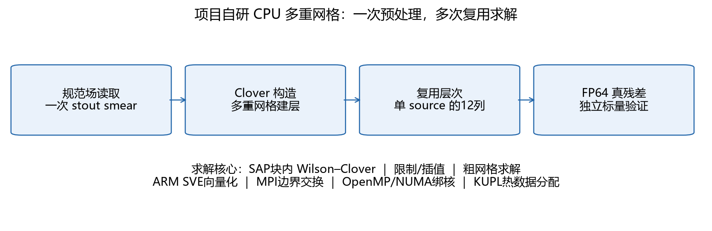
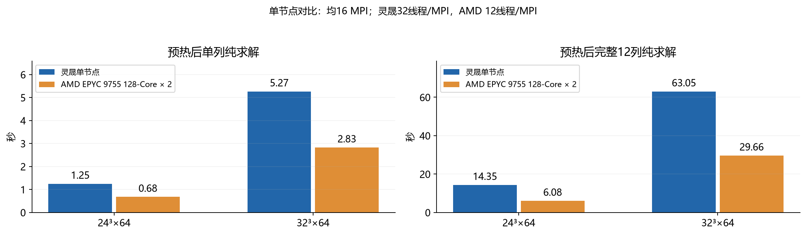

# 灵晟测试报告

**用途：申请多节点资源开展大格点 LQCD 传播子求解测试。** 求解数据截至2026年11月14日；硬件调度信息于2026年11月15日复核。

## 1. 项目与已完成工作

GitHub：[**WanbaoLi/multigrid.cpp**](https://github.com/WanbaoLi/multigrid.cpp)。
项目实现面向CPU的 Wilson–Clover 多重网格传播子求解，支持x86和灵晟ARM后端，保留独立标量程序进行精度验证。以下性能来自项目自研求解器。

| 灵晟开发与优化 | 当前状态 |
|---|---|
| 实现Wilson–Clover半自旋投影/恢复、SVE向量核与寻址复用，并完成实机验证 | 已完成 |
| 实现SAP块内偶奇Schur预条件、粗网格偶奇求解 | 已完成 |
| 实现每NUMA域一个MPI的绑核方案：单节点16 MPI、求解32线程/MPI，按两列批量处理 | 已完成 |
| 实现MPI halo通信与内部计算重叠、批量归约 | 已完成 |
| 接入KUPL，对部分热数据进行HBW分配，并验证SDK分类及页面驻留 | 已完成 |
| 共享单节点只读系数，完成24³×64、32³×64单列和12列精度及性能验证 | 已完成 |
| 实现多节点本地数据/halo驻留、basis手征零块压缩、建层临时数据释放和Krylov缓存控制，完成两节点C24验证 | 已完成 |
| 完成64³×128多节点建层及预热后1列、12列求解验证 | 未完成 |
| 通过跨向量复用halo页进一步降低内存峰值（已有实验实现，尚未验证） | 未完成 |
| 生成规范场：开发并验证生产用LQCD规范场生成流程 | 未完成 |

## 2. 当前性能与精度

统一16 MPI、零初值、一次stout、复用同一层次；MG/SAP热路径FP32，外部场和完整真残差检查FP64，**相对真残差≤10⁻⁸**。预热后取第2、3次中位数。纯求解不含读取、smear、Clover构造、建层、输出和外部独立验证；API墙钟另计。

| 平台 | 格子 | 单列纯求解/s | 12列纯求解/s | 12列API墙钟/s |
|---|---|---:|---:|---:|
| 灵晟单节点 | 24³×64 | 1.250 | 14.348 | 14.853 |
| 灵晟单节点 | 32³×64 | 5.267 | 63.049 | 63.850 |
| AMD EPYC 9755 128-Core × 2 | 24³×64 | 0.681 | 6.084 | 6.216 |
| AMD EPYC 9755 128-Core × 2 | 32³×64 | 2.829 | 29.662 | 29.989 |

灵晟使用32求解线程/MPI，AMD使用12线程/MPI；这是各自现有配置的端到端对照，不能据此单独归因于CPU架构。单节点数据均通过单列及12列独立算子检查，灵晟最大独立残差低于4.9×10⁻⁹。灵晟C24/C32建层分别约224.6/487.8秒，建层可跨source复用。分块分别为6×6×6×4、8×8×8×4。

## 3. 当前限制与优化重点

2026年11月15日复核灵晟计算节点cn12118的调度器信息：双路72F5、16个CPU NUMA域，608个物理核中592个可供应用使用；报告频率为2000 MHz。内存总量578560 MB，系统预留61440 MB，可供应用调度517120 MB，均保留调度器原单位。上述为节点配置读数，不是负载下持续频率、内存带宽或HBM容量实测。

- **主频与控制开销：** 计算节点探针报告最高频率约2 GHz，尚无全核持续频率测量。小矩阵、间接寻址、归约和线程同步依赖单核效率，不能直接用整机峰值浮点算力推算求解时间。
- **HBM使用范围：** KUPL已验证部分热数据进入HBW；当前自设预算为1 GiB/MPI，并非硬件容量上限，原始副本仍保留。C64两节点时每MPI的FP32 basis约2.25 GiB，超过该预算，无法整块放入当前热数据分配策略。尚无“全求解数据驻留HBM”或“带宽已打满”的证据。
- **库与指令：** 使用HPCKit 25.1、HMPI和KUPL，当前热算术主要由项目SVE内核完成；未将KML BLAS/SME作为已验收的主求解路径。粗网格48×48复数小矩阵调用需要同时评估布局转换、调用开销和线程嵌套。
- **收敛与通信：** 灵晟C32平均外层迭代约43.6次，C24约24.1次；格点增大和迭代增加共同放大耗时。多节点32进程通信门禁已通过；目前可运行基线使用限定网段的TCP，仍需官方协助验证高性能互连配置。

## 4. 大格点内存与资源申请

64³×128的格点总量是24³×64的约37.9倍。仅FP64的12列传播子输出就需全局72 GiB；此外还需要规范场、Clover、粗化basis、24个建层向量、Krylov缓存和MPI边界区。传输的薄面元素少，不等于其分块布局触及的驻留页少。

**C64两节点实测：** 已完成读取、smear、规范场装载和首轮24个建层向量；调度器单节点峰值记录为472932 MB，接近申请的480000 MB。随后远端MPI daemon失联，建层未完成；日志未直接确认内核OOM，故只能判断内存余量不足、内存压力可疑。**尚无有效C64单列或12列求解时间。**

容量预测采用：**预计每节点内存＝已测每节点内存×新旧格点总量之比×原节点数/新节点数**。它只作资源规划；实际halo、分块、缓存和建层峰值会改变比例。

**本次申请：4个整节点，每节点16 MPI、每MPI 32线程；每节点预留480000 MB内存，首轮墙钟4小时。** 对应64 MPI、2048个计算线程，整节点计费CPU配额约2432（当前限制1216）。采用时间拓扑1×1×1×64、本地格点64³×2、聚合块8×8×8×2。当前均匀时间切分下，3节点的48 MPI不能整除时间长度128，下一档可行配置为4节点。

申请目标：完成64³×128的建层与独立精度验证，测量预热后1列和12列纯求解时间、真实内存峰值，并验证HBW驻留及高性能互连效果。四节点结果尚未实测；进一步降低内存的实验也未作为验收结果。

数据依据：[单节点验收](https://github.com/WanbaoLi/multigrid.cpp/blob/b182d74/docs/single-node-health-20261113.md)、[多节点实验记录](https://github.com/WanbaoLi/multigrid.cpp/blob/b182d74/experiments/distributed-C64-20261114/README.md)。单节点测量版本`efe57de`，C64尝试版本`88e8bbe`；未验证halo页实验位于`codex/c64-halo-pages`。
