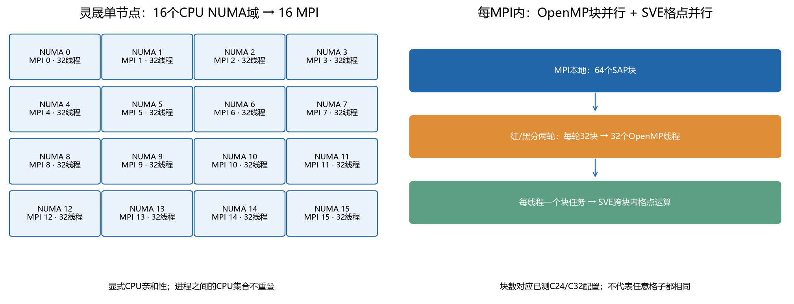
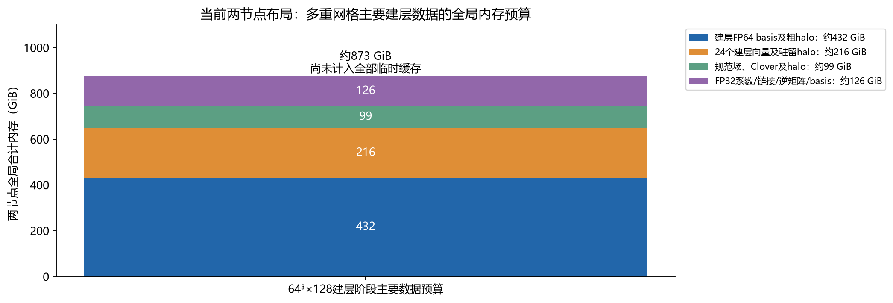
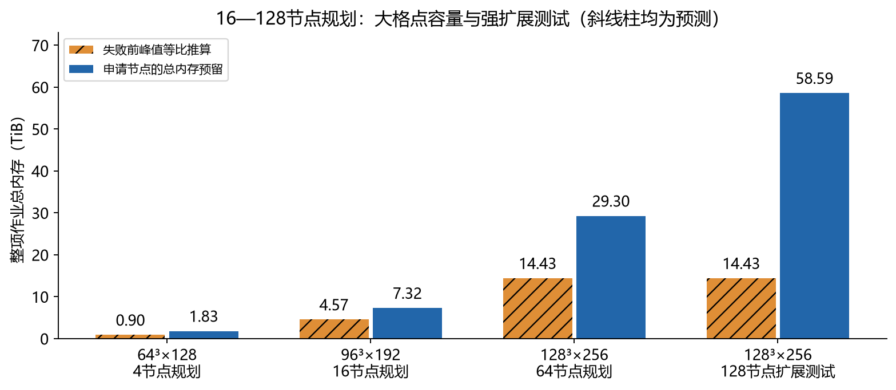

# 灵晟测试报告

**用途：申请多节点资源开展大格点 LQCD 传播子求解测试。** 求解数据截至2026年11月14日；硬件调度信息于2026年11月15日复核。

## 1. LQCD背景与计算任务

格点量子色动力学（LQCD）把强相互作用中的夸克和胶子问题离散到四维时空格点上，用于研究强子质量、结构与相互作用。计算通常先生成描述胶子背景的规范场组态，再在这些背景上求夸克传播子，最终构造关联函数并对组态做统计平均。[背景参考：Argonne LQCD项目](https://www.alcf.anl.gov/science/projects/lattice-qcd)、[PDG格点QCD综述](https://pdg.lbl.gov/2016/reviews/rpp2016-rev-lattice-qcd.pdf)。

**本项目当前计算的是传播子，规范场生成尚未完成。** 输入为真实规范场文件，在一个源点分别求解4个自旋、3个颜色组合对应的12个线性系统，得到完整12列传播子。可写作 `D ψ = b`：`D`是由规范场、夸克质量和Clover改进项决定的离散Dirac算子，`b`是给定自旋/颜色的源，`ψ`是求得的传播子一列。格子尺寸如64³×128表示三个空间方向各64点、时间方向128点。

大格点包含数千万乃至数亿格点；每轮迭代需反复访问邻点、自旋与颜色分量，并进行全局归约。轻夸克问题的迭代收敛更困难，还要在多份组态上积累统计。因此同时需要超算的计算吞吐、内存容量、带宽和低延迟互连。多重网格通过粗网格校正低频误差，配合细网格平滑降低迭代成本，层次可跨source复用。

## 2. 项目与已完成工作

GitHub：[**WanbaoLi/multigrid.cpp**](https://github.com/WanbaoLi/multigrid.cpp)。
项目实现面向CPU的 Wilson–Clover 多重网格传播子求解，支持x86和灵晟ARM后端，保留独立标量程序进行精度验证。以下性能来自项目自研求解器。


| 灵晟开发与优化 | 当前状态 |
|---|---|
| 实现Wilson–Clover半自旋投影/恢复、SVE向量核与寻址复用，并完成实机验证 | 已完成 |
| 实现SAP块内偶奇Schur预条件、粗网格偶奇求解 | 已完成 |
| 实现每NUMA域一个MPI的绑核方案：单节点16 MPI、求解32线程/MPI，按两列批量处理 | 已完成 |
| 实现MPI halo通信与内部计算重叠、批量归约 | 已完成 |
| 接入KUPL，对部分热数据进行HBW分配，并验证SDK分类及页面驻留 | 已完成 |
| 共享单节点只读系数，完成24³×64、32³×64单列和12列精度及性能验证 | 已完成 |
| 实现多节点本地数据/halo驻留、basis手征零块压缩、建层临时数据释放和Krylov缓存控制，完成两节点C24验证 | 已完成 |
| 完成64³×128多节点建层及预热后1列、12列求解验证 | 未完成 |
| 通过跨向量复用halo页进一步降低内存峰值（已有实验实现，尚未验证） | 未完成 |
| 生成规范场：开发并验证生产用LQCD规范场生成流程 | 未完成 |
| 完成4—128节点大格点适配、精度验证及扩展性测试 | 未完成 |

## 3. 算法与三级并行设计

### 3.1 求解流程

规范场读取 → 一次stout smear → Clover构造 → 生成24个测试向量并构建手征分裂的粗空间 → 建粗算子 → 复用层次完成12列求解。当前两层MG的一个V-cycle按**限制到粗网格、粗网格求解、插值回细网格、红黑SAP平滑**执行；外层使用GCR（广义共轭残差）迭代和FP64可靠残差更新；SAP为Schwarz交替过程平滑，MG为多重网格。24个测试向量分为两个手征子空间，形成48个粗自由度。12列按每批两列推进，各列保持独立收敛状态，属于同一source内批处理，不是多个source并行。

[源码：src/solver/native/cycle.cpp](https://github.com/WanbaoLi/multigrid.cpp/blob/a3ffff1992da6b7cf3ab426392907a9782f25c19/src/solver/native/cycle.cpp#L114)

```cpp
    // Coarse correction followed by red-black SAP (paper Algorithm 2).
    double t = wall_seconds();
    restrict_to_coarse(source, coarse_rhs);
    restrict_seconds += wall_seconds() - t;
    t = wall_seconds();
    coarse_solve(coarse_rhs, coarse_correction);
    coarse_seconds += wall_seconds() - t;
    t = wall_seconds();
    prolongate_add(coarse_correction, dest);
    prolong_seconds += wall_seconds() - t;
    t = wall_seconds();
    sap(source, dest, sap_cycles);
```
摘录中的`source`为当前细网格输入，`dest`为校正输出；`coarse_rhs`为限制后的粗网格右端，`coarse_correction`为粗解，`sap_cycles`为SAP循环次数，计时变量`t`用于阶段耗时。函数中的阶段计时是局部诊断，不直接等同整次MPI墙钟。

### 3.2 MPI：每个NUMA域一个进程

灵晟单节点有16个CPU NUMA域，每域38个物理核，其中一个为系统预留核，应用可用37核。当前每域配置一个MPI进程，求解使用其中32个核；单节点16 MPI×32线程，共512个求解线程。已测单节点建层采用37线程/MPI，求解切换为32线程，不重建层次；多节点实验固定32线程/MPI。

当前MPI实现按时间方向均匀切分：单节点16进程的拓扑为1×1×1×16，24³×64和32³×64每进程都持有4个时间片。跨进程只交换Wilson算子需要的前后物理时间面；粗层另交换所需粗网格边界。发送/接收缓冲区与计算数据分开，用非阻塞通信覆盖内部格点计算，然后等待并计算边界。MPI调用位于主线程；非阻塞调用并不自动保证通信真正被隐藏，仍需实机profile。

单节点模式通过共享窗口减少只读FP64系数副本；多节点实验采用本地拥有数据加halo驻留。各进程的spinor和Krylov工作区仍是私有的，不能把“CPU可共享地址空间”理解为程序已消除所有副本。HBW分配与CPU绑核也分别验证。

非阻塞边界交换的真实代码如下：

[源码：src/solver/native/fine_operator.cpp](https://github.com/WanbaoLi/multigrid.cpp/blob/a3ffff1992da6b7cf3ab426392907a9782f25c19/src/solver/native/fine_operator.cpp#L148)

```cpp
    auto post_halo = [&] {
        MPI_Irecv(recv_upper.data(), count, MPI_FLOAT, next, 10, native_comm, &requests[0]);
        MPI_Irecv(recv_lower.data(), count, MPI_FLOAT, prev, 11, native_comm, &requests[1]);
        MPI_Isend(send_lower.data(), count, MPI_FLOAT, prev, 10, native_comm, &requests[2]);
        MPI_Isend(send_upper.data(), count, MPI_FLOAT, next, 11, native_comm, &requests[3]);
        trace.post(count);
    };
```
`prev/next`是前后相邻MPI进程，`count`是发送的FP32元素数，`send_lower/send_upper`是下/上时间面发送缓冲区，`recv_lower/recv_upper`是对应接收缓冲区；`native_comm`为求解通信域，`requests`保存四个非阻塞请求，10/11为配对消息标签。`trace`记录通信诊断。发送完成前不覆盖发送数据。



### 3.3 OpenMP：并行SAP块，SVE并行块内格点

已测C24用6×6×6×4聚合块，C32用8×8×8×4。两种几何的全局粗网格都为4×4×4×16，共1024块；16 MPI分配后每进程64块。红黑着色分两轮，每轮32个块，`schedule(static)`将块任务分给32线程。每个线程复用`thread_local`局部缓冲区，避免每块反复分配；同一个块内执行偶奇Schur求解。36线程不会自然增加每轮32个块的任务数量，故保留32线程配置。

[源码：src/solver/native/sap.cpp](https://github.com/WanbaoLi/multigrid.cpp/blob/a3ffff1992da6b7cf3ab426392907a9782f25c19/src/solver/native/sap.cpp#L78)

```cpp
#pragma omp parallel
            {
                // A worker reuses its block buffers across colors, V-cycles and
                // RHS columns. Only owned block entries are read below.
                static thread_local FloatField rr, ar, dx;
                rr.resize(24 * block_sites);
                ar.resize(24 * block_sites);
                dx.resize(24 * block_sites);
#pragma omp for schedule(static)
                for (int task = 0; task < tasks; task++) {
                    const int cb = sap_schedule ? blocks[task] : first_aggregate + task;
                    if (colors[cb] == color) {
                        size_t offset = (size_t)cb * 24 * block_sites;
                        for (int j = 0; j < 24 * block_sites; j++) {
                            rr[j] = b[offset + j] - image[offset + j];
                            dx[j] = 0;
                        }
                        if (sap_eo)
                            solve_sap_block_eo(cb, rr, ar, dx, b.data() + offset,
                                               image.data() + offset);
```
`cb`是聚合块编号，`color`为当前红/黑颜色，`tasks`为块任务数，`block_sites`为每块格点数；`rr`、`ar`、`dx`分别为局部残差、算子图像和校正缓冲区，`b`为输入右端，`image`为当前解的算子图像，`offset`为该块在24个实数分量中的起点。`sap_eo`表示启用偶奇Schur路径。24个实数分量来自4自旋×3颜色×复数实/虚两部分。

### 3.4 核心Wilson–Clover算子与SVE向量化

热路径的Wilson–Clover应用由本地Clover项和八个正/负方向的邻点hopping组成。hopping先把四自旋投影为两自旋，执行SU(3)复数矩阵与颜色向量乘法，再恢复四自旋并累加。数据采用**聚合块内分量分离布局**：每个自旋/颜色的实部与虚部各自沿格点连续存放，便于SVE跨格点加载；不是直接把外部规范场文件当作SIMD布局使用。

以下均为仓库真实源码摘录，省略外围循环。`B`表示块内格点数，`site`为本次向量起始格点，`end`为范围末端；`svcntw()`查询当前SVE可容纳的FP32元素数。已归档计算节点向量长度为64字节，对应16个FP32元素；代码使用谓词保护尾部和无效邻点，不把512位理论峰值当作实测吞吐。[SVE接口参考：Arm ACLE](https://arm-software.github.io/acle/main/acle.html)。

**① 沿格点循环，创建有效lane谓词。**

[源码：src/backends/arm/wilson_sve.hpp](https://github.com/WanbaoLi/multigrid.cpp/blob/a3ffff1992da6b7cf3ab426392907a9782f25c19/src/backends/arm/wilson_sve.hpp#L117)

```cpp
    for(int site=begin;site<end;site+=svcntw()) {
        const svbool_t pg=svwhilelt_b32((uint64_t)site,(uint64_t)end);
        const int count=(end-site<(int)svcntw()?end-site:(int)svcntw());
        for(int dir=0;dir<8;++dir) {
            const auto index=sve_indices(pg,neighbor+(size_t)dir*B+site,count);
            const auto valid=svcmpge_n_s32(pg,index,0);
            if(!svptest_any(pg,valid)) continue;
```
`pg`标记本向量未越过`end`的lane，`count`为有效lane数；`dir`是八个方向的编号，`neighbor`为邻点索引表，`index`为向量邻点索引，`valid`进一步屏蔽负索引。`begin`是处理范围起点。尾部不能按整向量无条件读取。

**② 连续加载或gather加载。**

[源码：src/backends/arm/wilson_sve.hpp](https://github.com/WanbaoLi/multigrid.cpp/blob/a3ffff1992da6b7cf3ab426392907a9782f25c19/src/backends/arm/wilson_sve.hpp#L36)

```cpp
inline svfloat32_t sve_source_load(svbool_t valid, const float *source,
                                   svint32_t index, bool contiguous,
                                   std::ptrdiff_t base) {
    if (contiguous)
        return svld1_f32(valid, source + base);
    return svld1_gather_s32index_f32(valid, source, index);
}
```
`source`为分量数据起点，`base`为连续加载偏移，`contiguous`表示寻址计划已确认邻点连续；否则按`index`进行gather。当前验收profile开启`LQCD_ARM_SVE_REUSE=1`，但`LQCD_ARM_SVE_PLANNED=0`，因此不能把所有加载描述为已变成连续加载。

**③ 半自旋投影：一次投影供三个输出颜色复用。**

[源码：src/backends/arm/wilson_sve.hpp](https://github.com/WanbaoLi/multigrid.cpp/blob/a3ffff1992da6b7cf3ab426392907a9782f25c19/src/backends/arm/wilson_sve.hpp#L150)

```cpp
                    for (int j = 0; j < 3; ++j) {
                        const float *v = src + (sp * 3 + j) * 2 * B;
                        const float *w = src + (gs * 3 + j) * 2 * B;
                        const auto vr = sve_source_load(valid, v, index, contiguous, base);
                        const auto vi = sve_source_load(valid, v + B, index, contiguous, base);
                        const auto wr = sve_source_load(valid, w, index, contiguous, base);
                        const auto wi = sve_source_load(valid, w + B, index, contiguous, base);
                        const auto zr = svsub_f32_x(pg, svadd_f32_x(pg, vr, svmul_n_f32_x(pg, wr, pr)), svmul_n_f32_x(pg, wi, pi));
                        const auto zi = svadd_f32_x(pg, svadd_f32_x(pg, vi, svmul_n_f32_x(pg, wi, pr)), svmul_n_f32_x(pg, wr, pi));
```
`sp`是保留的自旋分量，`gs`是Gamma矩阵关联的另一自旋分量，`j`是输入颜色；`src`为输入spinor数据，`v/w`分别指向两组分量，`vr/vi`和`wr/wi`分别为实部/虚部向量。`pr/pi`为投影复系数的实/虚部，`zr/zi`为投影后的复数向量。投影结果随后供三个输出颜色复用，减少重复读取与投影计算。

**④ SU(3)颜色乘法：复数乘加。**

[源码：src/backends/arm/wilson_sve.hpp](https://github.com/WanbaoLi/multigrid.cpp/blob/a3ffff1992da6b7cf3ab426392907a9782f25c19/src/backends/arm/wilson_sve.hpp#L80)

```cpp
    const float *u = links + (dir * 9 + Color * 3 + j) * 2 * B + site;
    const auto ar = svld1_f32(valid, u), ai = svld1_f32(valid, u + B);
    hr = svadd_f32_x(pg, hr, svsub_f32_x(pg, svmul_f32_x(pg, ar, zr), svmul_f32_x(pg, ai, zi)));
    hi = svadd_f32_x(pg, hi, svadd_f32_x(pg, svmul_f32_x(pg, ar, zi), svmul_f32_x(pg, ai, zr)));
```
`links`为已准备好的方向链接系数，模板参数`Color`是输出颜色，`u`为当前矩阵元素；`ar/ai`是矩阵元素实/虚部，`hr/hi`是该输出颜色的累加向量。代码显式执行复数乘法和加减，不能仅凭这些intrinsic断言编译器一定生成特定FMA序列。

**⑤ 恢复自旋并写回。**

[源码：src/backends/arm/wilson_sve.hpp](https://github.com/WanbaoLi/multigrid.cpp/blob/a3ffff1992da6b7cf3ab426392907a9782f25c19/src/backends/arm/wilson_sve.hpp#L91)

```cpp
    float *yr = out + (sp * 3 + Color) * 2 * B + site, *yi = yr + B;
    float *lr = out + (gs * 3 + Color) * 2 * B + site, *li = lr + B;
    svst1_f32(pg, yr, svadd_f32_x(pg, svld1_f32(pg, yr), hr));
    svst1_f32(pg, yi, svadd_f32_x(pg, svld1_f32(pg, yi), hi));
    svst1_f32(pg, lr, svadd_f32_x(pg, svld1_f32(pg, lr),
        svsub_f32_x(pg, svmul_n_f32_x(pg, hr, rr), svmul_n_f32_x(pg, hi, ri))));
    svst1_f32(pg, li, svadd_f32_x(pg, svld1_f32(pg, li),
        svadd_f32_x(pg, svmul_n_f32_x(pg, hi, rr), svmul_n_f32_x(pg, hr, ri))));
```
`out`为输出块，`yr/yi`指向保留自旋的实/虚部，`lr/li`指向恢复自旋的实/虚部；`rr/ri`是恢复复系数。恢复使用前面算出的`hr/hi`，按相应Gamma结构累加回四自旋。Clover项则在每个格点上完成两个手征6×6复数块的乘法。

当前主要限制包括不规则gather、系数/basis数据搬运、复数算术和地址计算、粗网格小矩阵及全局归约。FP64峰值很高并不意味着当前以FP32热路径为主的混合精度求解会同比加速；HBM、SVE/SME、KML调用与通信都需要结合真实profile逐项评估。

## 4. 当前性能与精度

统一16 MPI、零初值、一次stout、复用同一层次；MG/SAP热路径FP32，外部场和完整真残差检查FP64，**相对真残差≤10⁻⁸**。预热后取第2、3次中位数。纯求解不含读取、smear、Clover构造、建层、输出和外部独立验证；API墙钟另计。

| 平台 | 格子 | 单列纯求解/s | 12列纯求解/s | 12列API墙钟/s |
|---|---|---:|---:|---:|
| 灵晟单节点 | 24³×64 | 1.250 | 14.348 | 14.853 |
| 灵晟单节点 | 32³×64 | 5.267 | 63.049 | 63.850 |
| AMD EPYC 9755 128-Core × 2 | 24³×64 | 0.681 | 6.084 | 6.216 |
| AMD EPYC 9755 128-Core × 2 | 32³×64 | 2.829 | 29.662 | 29.989 |


灵晟使用32求解线程/MPI，AMD使用12线程/MPI；这是各自现有配置的端到端对照，不能据此单独归因于CPU架构。单节点数据均通过单列及12列独立算子检查，灵晟最大独立残差低于4.9×10⁻⁹。灵晟C24/C32建层分别约224.6/487.8秒，建层可跨source复用。分块分别为6×6×6×4、8×8×8×4。

## 5. 测试方法与已有证据

| 测试层次 | 已完成内容 | 结论边界 |
|---|---|---|
| 单节点真实组态 | C24、C32；两平台均16 MPI；一次建层后各3次单列、3次12列 | 第2/3次中位数为预热后成绩，API与纯求解分开 |
| 数值精度 | 零初值；完整FP64真残差；最后单列及全部12列再用独立标量算子检查 | 每组13次独立检查，停止门限10⁻⁸；没有用局部算子误差代替最终残差 |
| 运行库回归 | 2026-11-13两平台各30/30 CTest；普通/共享MPI、生命周期、批处理等 | 仅代表对应版本和配置 |
| 分布式存储回归 | 2026-11-14所选10/10 CTest通过，覆盖压缩basis、分布式单/多列、halo及SAP偶奇 | 小几何与共享/普通路径回归，不能代替大格点验收 |
| 两节点通信 | 32 MPI、每节点16；检查不重叠32核绑核、集合通信、8 MiB环形消息 | 显式TCP配置通过；高性能互连尚待官方协助验证 |
| 两节点真实C24 | 完成建层、单列和12列，13份输出通过独立标量检查 | 是分布式正确性证据，不作为单节点表中的性能数据 |
| 两节点真实C64 | 完成读入、smear、装载、首轮24个建层向量；保存内存检查点 | 建层未完成、MPI daemon失联；无大格点性能成绩 |
| 新增计算节点SVE复查 | 2026-11-15，cn12038，作业2132585成功；Clover谓词/尾部及Wilson寻址/边界两项均PASS | 复用已归档测试二进制，记录SHA256；不是新增完整求解计时 |

记录保留输入哈希、源码提交、库哈希、MPI拓扑、线程/绑核、每列残差、迭代数、纠正求解和阶段耗时。后续16—128节点测试仍以单source完整12列、相对真残差≤10⁻⁸作为验收指标；分别记录setup、纯求解、API墙钟、内存峰值和通信等待，避免用局部算子加速替代端到端收益。

质量参数`mass`与Clover系数`csw`如下；两种输入均执行一次四方向stout，强度`rho=0.125`。时间采用反周期边界，外部场使用DeGrand–Rossi自旋基，setup随机种子1024。完整输入哈希见文末验收记录。

| 已验收格子 | mass（质量参数） | csw（Clover系数） | 聚合块 |
|---|---:|---:|---|
| 24³×64 | -0.277 | 1.160920226 | 6×6×6×4 |
| 32³×64 | -0.279 | 1.1606789224 | 8×8×8×4 |

新增探针同时记录：页大小4096字节，可访问内存节点0—31，Linux可见总内存592446008 KiB、无swap；lscpu报告32个NUMA节点，包含16个CPU域与仅内存域，CPU配置范围1200—2000 MHz。未测满载持续频率和真实内存带宽。该物理内存读数与调度器578560 MB基本一致，因此本文GiB/TiB换算按其MiB计数口径处理。

## 6. 当前限制与优化重点

2026年11月15日复核灵晟计算节点cn12118的调度器信息：双路72F5、16个CPU NUMA域，608个物理核中592个可供应用使用；报告频率为2000 MHz。内存总量578560 MB，系统预留61440 MB，可供应用调度517120 MB，均保留调度器原单位。上述为节点配置读数，不是负载下持续频率、内存带宽或HBM容量实测。

- **主频与控制开销：** 计算节点探针报告最高频率约2 GHz，尚无全核持续频率测量。小矩阵、间接寻址、归约和线程同步依赖单核效率，不能直接用整机峰值浮点算力推算求解时间。
- **HBM使用范围：** KUPL已验证部分热数据进入HBW；当前自设预算为1 GiB/MPI，并非硬件容量上限，原始副本仍保留。C64两节点时每MPI的FP32 basis约2.25 GiB，超过该预算，无法整块放入当前热数据分配策略。尚无“全求解数据驻留HBM”或“带宽已打满”的证据。
- **库与指令：** 使用HPCKit 25.1、HMPI和KUPL，当前热算术主要由项目SVE内核完成；未将KML BLAS/SME作为已验收的主求解路径。粗网格48×48复数小矩阵调用需要同时评估布局转换、调用开销和线程嵌套。
- **收敛与通信：** 灵晟C32平均外层迭代约43.6次，C24约24.1次；格点增大和迭代增加共同放大耗时。多节点32进程通信门禁已通过；目前可运行基线使用限定网段的TCP，仍需官方协助验证高性能互连配置。

## 7. 总内存需求与16—128节点申请方案

大格点多重网格同时保存规范场、Clover、粗化basis、24个建层向量、粗算子和MPI边界区；求解时还需要Krylov缓存、可靠更新和布局转换缓冲区。当前实现仍有每MPI私有工作区及halo页放大，容量需求必须按整个求解程序计算。



64³×128当前两节点布局中，含halo的压缩FP64 basis约432 GiB，24个建层向量约216 GiB，规范场/Clover约99 GiB，FP32系数等约126 GiB，主要建层数据预算合计约873 GiB，尚未覆盖所有临时缓存。这是代码布局预算，不是各项硬件计数器实测；后续应继续减少副本和复用halo。

两节点任务每节点申请480000 MB，可靠单节点峰值记录达到472932 MB，随后远端MPI daemon失联，建层未完成。日志未直接确认内核OOM，但已暴露容量余量不足。HBW/HBM与全部可调度内存是不同口径，具体高速内存容量、模式及最优放置需平台协助确认。

容量规划暂取“2×可靠单节点峰值”约945864 MB为对称两节点布局的总量基线，按格点总数放大。两节点同时总峰值未可靠记录，而且原作业未完成，故这不是完整求解的实测上限。布局、分块和halo改变后需重新测量，需要在完整建层和求解中验证容量余量。



| 目标格点 | 相对64³×128体积 | 当前布局等比推算的作业总内存 | 资源阶段 |
|---|---:|---:|---|
| 64³×128 | 1倍 | 约0.90 TiB | 先用4节点完成已有真实组态验收；16节点开展空间MPI适配与扩展验证 |
| 96³×192 | 5.0625倍 | 约4.57 TiB | 16—32节点容量、收敛及性能验证 |
| 128³×256 | 16倍 | 约14.43 TiB | 64—128节点大格点及强扩展验证 |

TiB按调度器MB÷1048576换算；新计算节点探针确认其MB数值与系统MiB口径一致。后两种几何为规划目标，需准备对应组态；表中为内存量级预测，不能当作已完成的性能结果。提高物理格点规模还会增加迭代、粗层和通信成本，不能仅凭内存充足推算时间。

**申请方式：至少16个整节点起步，并提供分阶段扩展到64—128节点的测试额度。** 所有阶段保持每节点16 MPI、每MPI 32线程；每节点预留480000 MB内存，首次作业墙钟4小时，后续按完整建层和测量用时调整。

| 申请节点数 | MPI总进程 | 求解线程总数 | 作业总内存预留 | 整节点计费CPU配额约值 |
|---:|---:|---:|---:|---:|
| 16 | 256 | 8192 | 7.32 TiB | 9728 |
| 64 | 1024 | 32768 | 29.30 TiB | 38912 |
| 128 | 2048 | 65536 | 58.59 TiB | 77824 |

16节点用于容量与分布式软件适配，64—128节点用于大格点时间到解、同一几何的强扩展、不同几何的弱扩展以及互连/HBW效率研究。2026-11-14曾观测账号CPU上限1216；2026-11-15复查该限制项被拒绝访问，当前额度需管理员确认。

**适配工作已列入计划。** 现有生产MPI只支持时间方向切分；16—128节点不能只修改启动进程数，需要扩展空间方向邻居、数据布局和粗网格通信。候选逻辑拓扑按x、y、z、t排列如下，均为待实现、待验证设计：

| 规模与节点 | 候选MPI拓扑 | 每MPI本地格点 |
|---|---|---|
| 64³×128，16节点 | 2×2×2×32 | 32×32×32×4 |
| 96³×192，16节点 | 2×2×2×32 | 48×48×48×6 |
| 128³×256，64节点 | 4×4×2×32 | 32×32×64×8 |
| 128³×256，128节点 | 4×4×4×32 | 32×32×32×8 |

每阶段先核对MPI邻居、全局时间反周期边界、源点归一化和完整算子残差，再测预热后单列与完整12列。扩展性评估比较真实时间、迭代数、内存、通信等待及并行效率，保留最佳正确版本。希望平台提供高性能互连/HMPI配置、HBM容量和放置建议、频率及带宽计数器支持，协同完成国产众核CPU上的LQCD适配。

数据依据：[单节点验收](https://github.com/WanbaoLi/multigrid.cpp/blob/b182d74/docs/single-node-health-20261113.md)、[多节点实验记录](https://github.com/WanbaoLi/multigrid.cpp/blob/b182d74/experiments/distributed-C64-20261114/README.md)。单节点测量版本`efe57de`，C64尝试版本`88e8bbe`；未验证halo页实验位于`codex/c64-halo-pages`。
